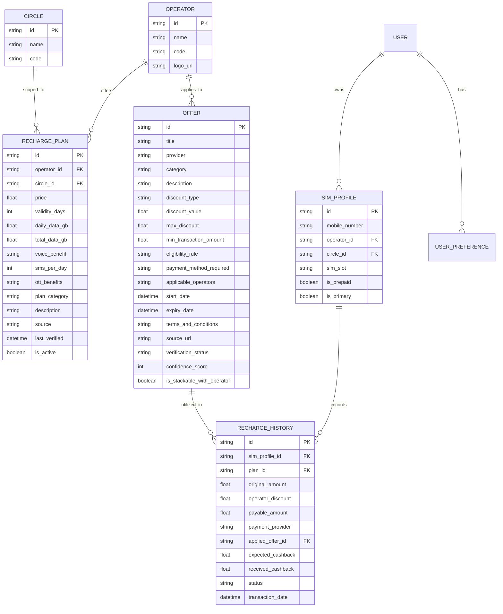

# Database Schema

## Relational Schema (PostgreSQL & SQLite Room)

The schema is synchronized between the backend database and the Android Room local database to ensure offline-first synchronization.

