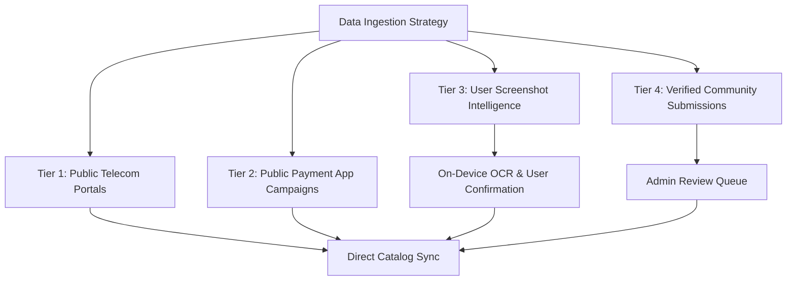

# Data Sources Strategy & Ingestion Policy

## 1. Ethical Ingestion Principles
BestRecharge adheres to strict ethical engineering and security practices:
- **No Unauthorized Private API Scraping**: BestRecharge does not reverse-engineer private endpoints protected by proprietary sessions or tokens.
- **No CAPTCHA / Bot Bypass**: No automated mechanisms bypass human verification screens.
- **No Background Accessibility Spying**: Accessibility Services are never used to sniff or record user interactions across banking apps.
- **Clear Provenance**: Every plan and offer displays:
  - `Source`: Official Portal, Public RSS/Feed, User Screenshot OCR, Verified Community.
  - `Last Verified Date`: ISO-8601 timestamp.
  - `Verification Status`: `OFFICIALLY_VERIFIED`, `PUBLICLY_SOURCED`, `USER_IMPORTED`, `EXPIRED`.

---

## 2. Ingestion Tiers

1. **Public Telecom Portals**:
   - Vodafone Idea (MyVi public prepaid plans catalog).
   - Reliance Jio (Jio.com public prepaid plans).
   - Bharti Airtel (Airtel.in public tariff list).
   - BSNL (BSNL portal public STV & PV listings).
2. **Payment Provider Campaigns**:
   - Publicly announced promotional campaigns (e.g. NPCI BHIM cashback initiatives, Paytm UPI campaign press releases and public terms).
3. **Screenshot OCR Intelligence**:
   - User snaps an offer screen in their operator or UPI app.
   - Google ML Kit extracts text locally.
   - Structured parser isolates amounts, dates, and conditions.
   - User verifies and saves to their device database.
