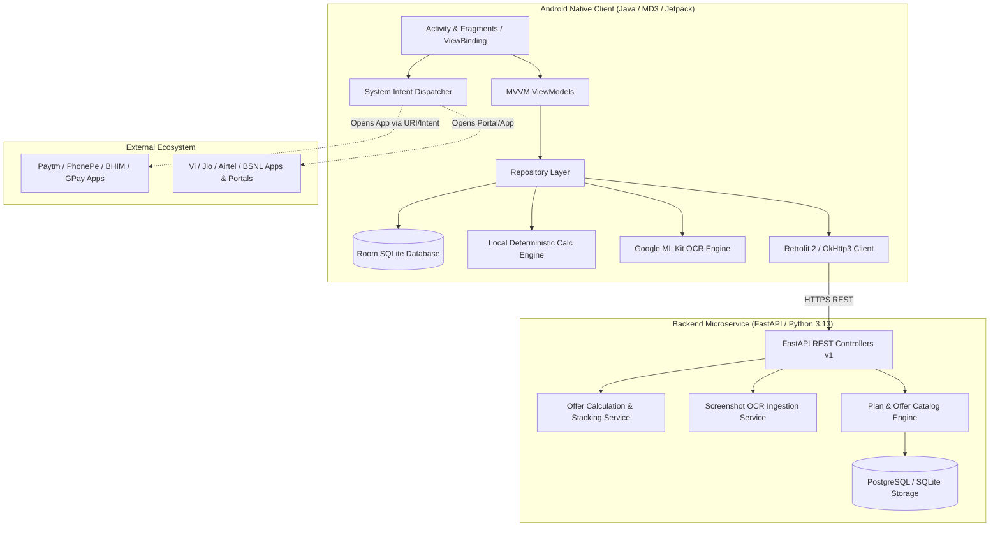

# System Architecture

## BestRecharge Architecture Overview

BestRecharge adopts a decoupled, offline-first native mobile architecture paired with a high-performance Python FastAPI backend microservice.

### Component Architecture

#### 1. Android Client Architecture
- **Language**: Java 17 (Pure Native Android).
- **Presentation Pattern**: Model-View-ViewModel (MVVM) with Android Jetpack Lifecycle (`ViewModel`, `LiveData`, `ViewBinding`).
- **Data Layer**:
  - `RoomDatabase` with SQLite caching for complete offline operation.
  - Data Access Objects (`PlanDao`, `OfferDao`, `SimDao`, `SavingsDao`, `PreferenceDao`).
  - Single Source of Truth `Repository` pattern.
- **Computation Engine**: Local Java implementation of the deterministic calculation engine (`DealCalculator`), ensuring that calculations work instantaneously with zero network latency or when disconnected.
- **Machine Learning**: Google ML Kit On-Device Vision Text Recognition (`com.google.android.gms:play-services-mlkit-text-recognition`).

#### 2. Backend Architecture
- **Framework**: FastAPI (Asynchronous Python 3.13).
- **ORM / Persistence**: SQLAlchemy 2.0 with PostgreSQL (and SQLite development fallback).
- **Calculation Layer**: Stateless, deterministic combinatoric evaluator evaluating:
  - Offer eligibility constraints.
  - Combination rules (e.g. 1 operator discount + 1 payment offer).
  - Effective cost formulas.
- **Provider Adapters**: Extensible adapter modules for standardizing disparate offer representations from Vi, Jio, Airtel, BSNL, Paytm, PhonePe, BHIM, and Google Pay.
